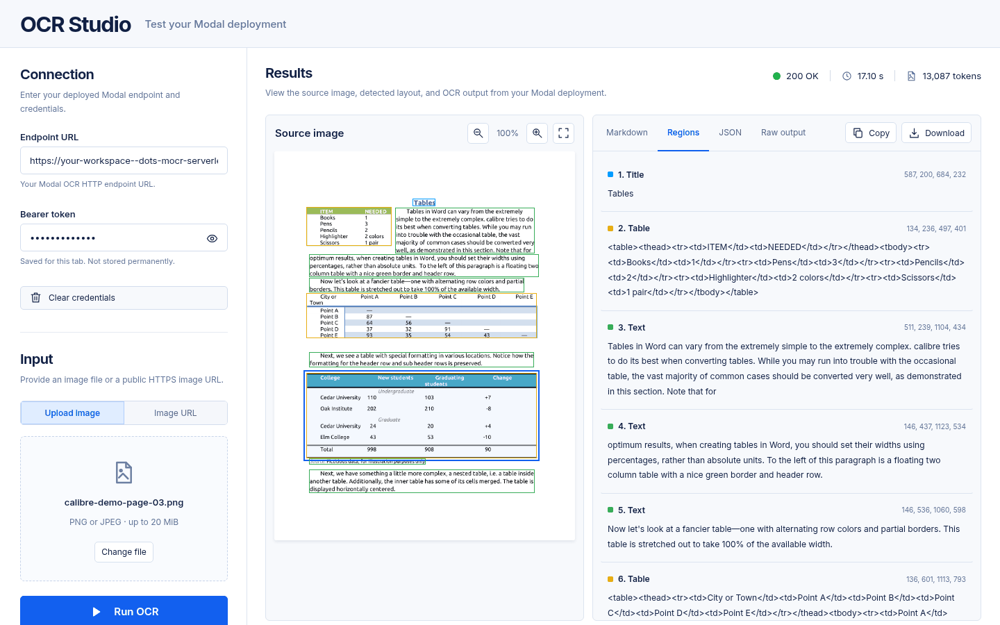
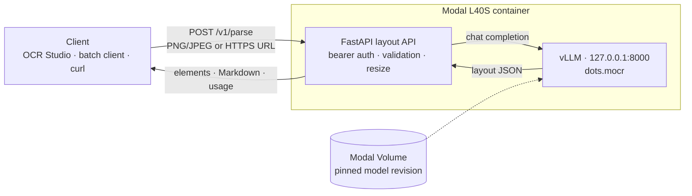
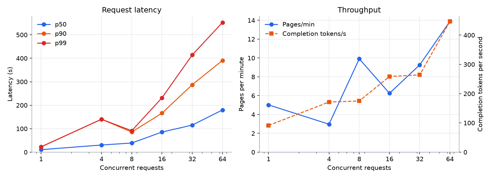
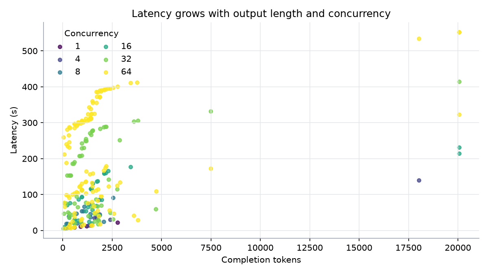
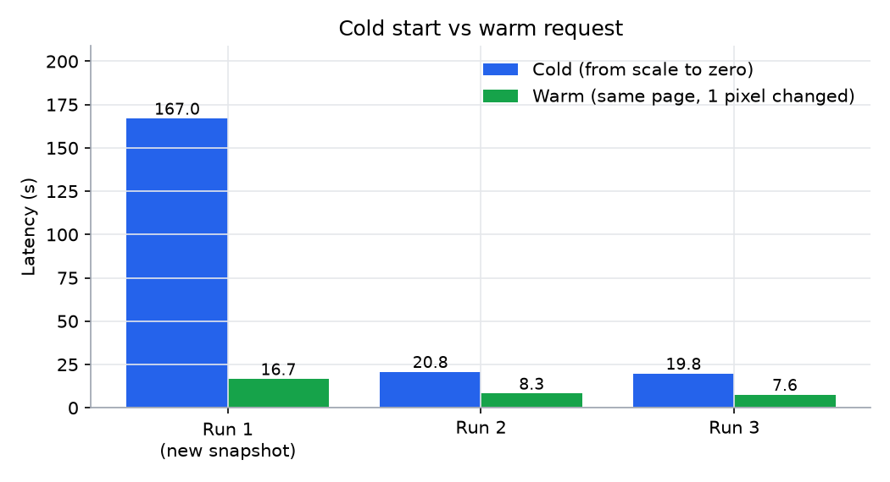
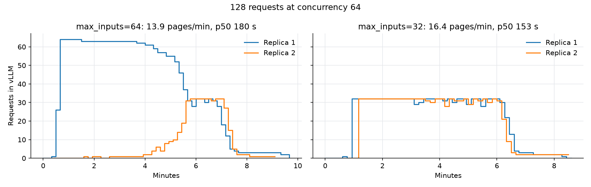
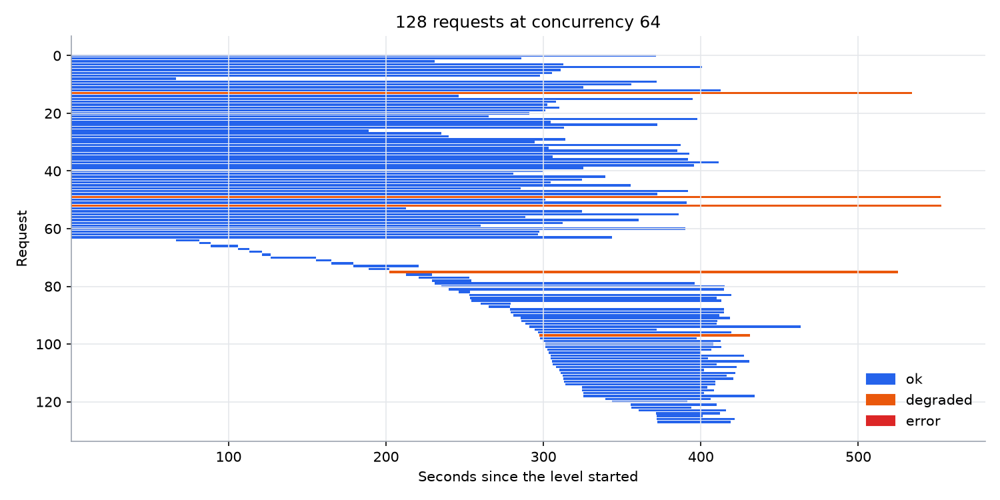
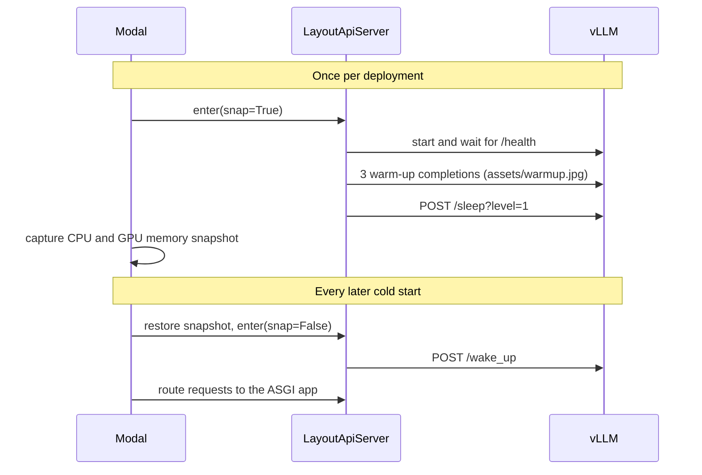
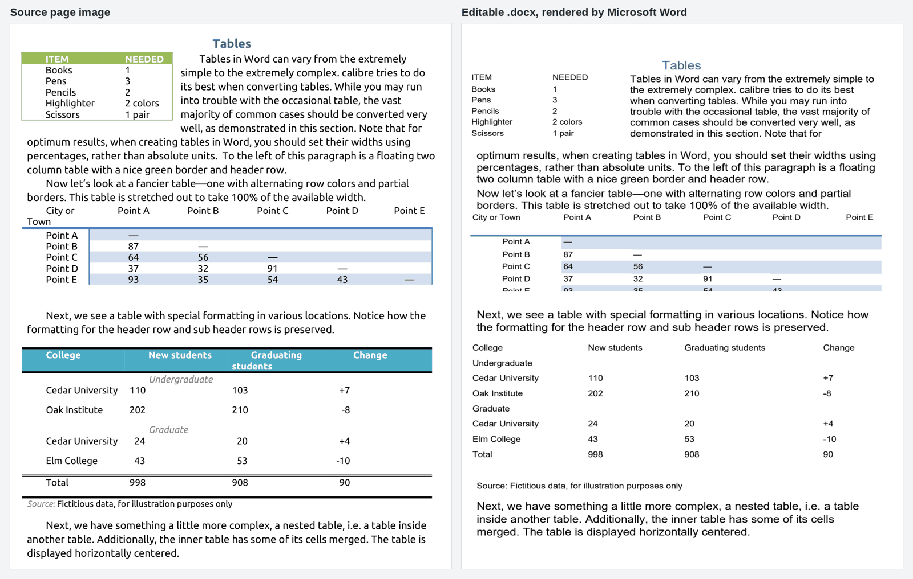

# dots.mocr Layout API on Modal

High-throughput, scale-to-zero document layout parsing with
[`dots-studio/dots.mocr`](https://huggingface.co/dots-studio/dots.mocr). The
public service is a small, protected API that accepts one PNG or JPEG and
returns everything needed to render the result: normalized layout elements,
Markdown, raw model output, dimensions, and token usage.

vLLM remains private inside each Modal GPU container. Concurrent API requests
are forwarded to its loopback-only OpenAI endpoint so vLLM can continuously
batch work on the GPU; the OpenAI-compatible routes are not publicly exposed.

[OCR Studio](playground/README.md) is a static frontend for testing a
deployment. It calls the API directly with your bearer token and displays image
regions, Markdown, raw output, and JSON.

Saved results can be turned into editable Word documents with the local
[Word exporter](word_export/README.md).



## Contents

- [How it works](#how-it-works)
- [Performance](#performance)
- [Deploy](#deploy)
- [API](#api)
- [Concurrent client and benchmark](#concurrent-client-and-benchmark)
- [Export editable Word documents](#export-editable-word-documents)
- [Runtime and security](#runtime-and-security)
- [Development](#development)
- [Model license and acceptable use](#model-license-and-acceptable-use)

## How it works



Each container runs the public API and a private vLLM server side by side.
Requests from many clients share one vLLM process, which batches them on the
GPU. Containers scale to zero when idle and restore from a memory snapshot.

## Performance

Measured on 2026-10-10 against this repository's deployment: L40S replicas,
vLLM `0.27.1`, and the settings in [Runtime and security](#runtime-and-security),
except that the sweep below allowed 64 concurrent inputs per replica; see
[Two replicas under a burst](#two-replicas-under-a-burst) for the current limit of 32.
Latency is end to end, timed by the [benchmark](#concurrent-client-and-benchmark)
running in a Modal container.

The 256 requests used 164 distinct document pages: arXiv papers rendered at
150 DPI, IRS forms, and the Word exporter's regression pages. Repeated pages had
one pixel changed so vLLM could not reuse cached images. The median request had
11,901 prompt tokens and 1,314 completion tokens.

| Concurrent requests | Requests | Pages/min | Completion tokens/s | p50 | p90 | Max | Degraded |
|---:|---:|---:|---:|---:|---:|---:|---:|
| 1 | 8 | 5.0 | 91 | 10.6 s | 22.5 s | 22.5 s | 0 |
| 4 | 8 | 3.0 | 171 | 30.5 s | 140.3 s | 140.3 s | 1 |
| 8 | 16 | 9.9 | 175 | 39.0 s | 85.7 s | 91.2 s | 0 |
| 16 | 32 | 6.3 | 259 | 85.7 s | 166.2 s | 231.6 s | 2 |
| 32 | 64 | 9.3 | 264 | 115.3 s | 287.4 s | 414.2 s | 1 |
| 64 | 128 | 13.9 | 447 | 179.8 s | 390.7 s | 552.7 s | 5 |

No request failed. A `degraded` response has unparseable layout JSON and no
layout boxes. Four pages, three of them dense IRS forms, did this every time
they ran: the model repeated content until it stopped at 18,016–20,059
completion tokens. One more page stopped normally at 2,888 tokens with
malformed JSON. A runaway page can dominate a small level: the 4-request level
spent 140 of its 162 seconds on one. Completion tokens per second is therefore
the steadier throughput measure.



Latency follows output length, and rises with the number of requests sharing a
GPU:



### Cold and warm starts

| Measurement | Result |
|---|---:|
| Warm request, single user, p50 | 10.6 s |
| Cold request after scale to zero, restored from the GPU snapshot | 19.8–20.8 s |
| The same page warm, one pixel changed | 7.6–8.3 s |
| Cold-start overhead: container restore ~9 s, vLLM wake-up ~1 s | ~12 s |
| First request when Modal builds a new GPU snapshot | 2.5–3 min |

Modal builds the snapshot on the first request after a deployment, which took
2 min 42 s, and occasionally again later; that happened on one of the three
measured cold starts (167 s).



### Two replicas under a burst

The sweep allowed one container to accept up to 64 requests
(`@modal.concurrent(max_inputs=64, target_inputs=32)`). When 64 requests
arrived at once, the warm replica took nearly all of them. A second replica
started, but received new requests only as the first one's requests finished,
so the load evened out only after about five minutes.

Lowering `max_inputs` to 32 makes Modal queue the overflow for the second
replica instead. Both replicas ran 32 requests within 15 seconds of the burst.
For the same 128 requests at concurrency 64, each from zero containers with one
warm-up request:

| Per-replica limit | Pages/min | Completion tokens/s | p50 | p90 | Max | Errors |
|---|---:|---:|---:|---:|---:|---:|
| `max_inputs=64` | 13.9 | 447 | 179.8 s | 390.7 s | 552.7 s | 0 |
| `max_inputs=32` (current) | 16.4 | 515 | 152.6 s | 327.0 s | 468.1 s | 0 |



Each configuration ran once. Repeating the 64-input level varied throughput by
about 10%, so the gain in throughput is modest; the even split between replicas
is the clear change. The 32-input limit costs nothing below 32 concurrent
requests. Above it, part of a burst on one warm replica waits about 15 seconds for the
second replica's cold start.



The raw per-request results are in
[`assets/benchmarks/2026-10-10.json`](assets/benchmarks/2026-10-10.json). Run the
[benchmark](#concurrent-client-and-benchmark) on your own documents, since
output length drives latency.

## Deploy

Install [`uv`](https://docs.astral.sh/uv/getting-started/installation/), sync the
locked project environment, and select the intended Modal profile:

```bash
uv sync --locked
uv run modal profile current
```

Generate a random OCR bearer token:

```bash
uv run python -c 'import secrets; print(secrets.token_urlsafe(32))'
```

Put `DOTS_MOCR_TOKEN=<generated-token>` in a private, ignored `.env` file,
then create the OCR secret:

```bash
uv run --with python-dotenv modal secret create dots-mocr-api --from-dotenv .env
```

The OCR API refuses to start without this token. If workspace policy blocks
URLs without Modal proxy authentication, that policy must allow this
application-authenticated endpoint before deployment.

Download the exact model revision into the persistent model Volume, then
deploy:

```bash
uv run modal run modal_app.py::download_model
uv run modal deploy modal_app.py
```

The deploy command prints a URL similar to:

```text
https://<workspace>--api.modal.run
```

The OCR API and bundled clients use `DOTS_MOCR_TOKEN` (or the clients' `--token`
option). The Modal CLI's `MODAL_TOKEN_ID`/`MODAL_TOKEN_SECRET` are separate
credentials. Never commit any of these secrets.

Deployment resources and scaling settings are declared directly on
`LayoutApiServer` in `modal_app.py`. Its snapshot hook starts and warms vLLM,
then puts it to sleep; the restore hook wakes vLLM before Modal serves the
FastAPI application directly through ASGI.



## API

`POST /v1/parse` accepts `multipart/form-data` containing exactly one of:

- `file`: a PNG or JPEG upload, at most 20 MiB.
- `image_url`: a public HTTPS URL returning PNG or JPEG content.

The prompt, model, temperature, top-p, and output-token limit are controlled by
the service. There is no prompt ID, custom prompt, model selection, or
streaming mode.

Upload a local image:

```bash
curl -L "$DOTS_MOCR_URL/v1/parse" \
  -H "Authorization: Bearer $DOTS_MOCR_TOKEN" \
  -F "file=@assets/warmup.jpg;type=image/jpeg"
```

Parse a remote image:

```bash
curl -L "$DOTS_MOCR_URL/v1/parse" \
  -H "Authorization: Bearer $DOTS_MOCR_TOKEN" \
  -F "image_url=https://example.com/document.png"
```

The successful response has this shape:

```json
{
  "request_id": "607c2c28d14549c4a730e6e228df91e7",
  "status": "ok",
  "warnings": [],
  "model": "dots-studio/dots.mocr",
  "image": {
    "original_width": 1600,
    "original_height": 2200,
    "model_input_width": 1596,
    "model_input_height": 2184
  },
  "elements": [
    {
      "bbox": [120, 80, 1480, 190],
      "category": "Title",
      "text": "Example document"
    }
  ],
  "markdown": "Example document",
  "raw_text": "[...]",
  "generation": {
    "finish_reason": "stop",
    "usage": {
      "prompt_tokens": 1234,
      "completion_tokens": 456,
      "total_tokens": 1690
    }
  }
}
```

Bounding boxes use the EXIF-oriented original image coordinate space and
preserve the model's reading order. Tables remain HTML, formulas are normalized for
Markdown/LaTeX renderers. `Picture` elements retain their bounding boxes but
are omitted from `markdown`. Clients use the original image and returned
coordinates to draw overlays or crop pictures; the API returns no image data.
OCR Studio draws interactive regions over the source image in the browser.

The API returns token usage; the benchmark client measures request latency and
throughput. The API does not collect per-stage timings.

If the completion contains malformed layout JSON, the API returns a usable
HTTP 200 response with `status: "degraded"`, `elements: null`, raw text as Markdown,
the untouched model output, and a warning.
The parser expects the model's JSON array of layout elements; it does not repair
truncated JSON or accept alternate wrapper objects.

Expected errors use FastAPI's standard error response:

```json
{
  "detail": "Provide exactly one of file or image_url"
}
```

The protected deployment also exposes `/health`, `/metrics`, `/docs`, and
`/openapi.json`. Every route requires `Authorization: Bearer <token>`.
CORS permits requests from any origin with the `Authorization` and
`Content-Type` headers, without cookies. Preflight requests do not require
authentication. Enter the token at runtime in the tester; never bake it into
static assets. Modal proxy authentication is disabled on this OCR endpoint
so browser preflight reaches the application's CORS middleware.
Authentication runs inside the GPU container, so rejected requests can
still incur container startup compute even though they cannot run OCR.

## Concurrent client and benchmark

The bundled client accepts any mixture of local PNG/JPEG paths and public HTTPS
URLs. It sends one image per request, preserves input ordering, and prints the
complete API responses:

```bash
export DOTS_MOCR_URL='https://<workspace>--api.modal.run'
export DOTS_MOCR_TOKEN='YOUR_OCR_BEARER_TOKEN'

uv run python -m scripts.batch_client \
  --base-url "$DOTS_MOCR_URL" \
  --concurrency 32 \
  assets/warmup.jpg \
  assets/example.png
```

Run a concurrency sweep after deployment or after materially changing the
workload. Use many distinct page images: vLLM caches repeated images, so a
sweep that cycles through a few pages overstates throughput. The sweep takes
images in order across all levels and warns when it has to reuse them.

```bash
uv run python -m scripts.benchmark \
  --base-url "$DOTS_MOCR_URL" \
  --levels 1,4,8,16,32,64 \
  --output benchmark.json \
  pages/*.png
```

Each level sends `max(8, 2 × concurrency)` requests unless
`--requests-per-level` is set. The report gives each level's ok, degraded, and
error counts, requests per second, prompt and completion tokens per second, and
mean, p50, p90, p95, p99, and maximum latency. `--output` also saves every
request's start offset, latency, status, and token counts for plotting.

## Export editable Word documents

The optional [Word exporter](word_export/README.md) turns saved OCR results, such
as the batch client's output, and their original page images into one editable
`.docx`. It runs locally, uses Pandoc for content conversion, and places text,
native tables, native equations, and cropped pictures at their source positions.

```bash
uv run --extra word python -m word_export \
  --results results.json \
  --output document.docx \
  page1.png page2.jpg
```



See the [Word exporter guide](word_export/README.md) for the full workflow,
scanned and rotated pages, the conversion engine, fidelity limits, and rendered
checks.

## Runtime and security

- vLLM `0.27.1`, Modal `1.5.4`, one L40S, 8 CPU cores, and 24 GiB host memory
  per replica.
- Model revision `e539fbb52280393adc081b289ec597430a0f9031` is stored under
  `/models/DotsMOCR-e539fbb5` in a persistent Modal Volume.
- Each replica accepts at most 32 concurrent inputs, which is also vLLM's
  batch limit. Additional demand scales horizontally up to a hard limit of two
  replicas; requests beyond 64 wait in Modal's queue.
- Replicas scale to zero after 30 idle seconds. No buffer replica is kept
  warm while the service is active.
- The Modal Function timeout and bundled client timeout are 15 minutes.
  The private inference request has a 14-minute timeout, leaving room for image
  transfer, processing, and returning the response. Container startup has a
  separate 30-minute timeout for model initialization and snapshot creation.
- Modal CPU/GPU memory snapshots capture a warmed vLLM process. vLLM is put
  into level-one sleep before capture and restored before the public API is
  marked ready, reducing repeated model initialization work after scale-to-zero.
- Snapshot warm-up uses the bundled `assets/warmup.jpg` document,
  the same image preprocessing as the parse API, and three 16-token completions.
- Image preparation uses Pillow's Lanczos resizing directly, retaining the
  previous 200/96 scale, pixel limits, and 28-pixel grid without converting
  through PDF. Resampling changes the pixels, so OCR output may differ.
  Preparation runs in Starlette's thread pool; inference uses asynchronous HTTP.
  Decoded original and model images are closed before inference starts. Only
  dimensions and the encoded model request are retained while awaiting vLLM.
- Remote images must use HTTPS. The service rejects private/reserved addresses,
  revalidates redirects, disables environment proxies, and limits download size
  and duration. Pillow checks the actual PNG/JPEG format when decoding.
  The address check happens before httpx connects, so it does not stop DNS
  rebinding; use network egress rules if strict isolation is required.
- Requests may exceed Modal's initial 150-second web interval during cold starts
  or long generations. Clients must follow redirects (`curl -L`; enabled in the
  bundled client).

## Development

```bash
uv sync --locked --extra word
uv run python -m unittest discover -s tests
```

- `layout_api.py`: the FastAPI service that runs inside each GPU container.
- `modal_app.py`: Modal images, model download, and the snapshot-aware server.
- `word_export/`: the Word exporter library (`python -m word_export`).
- `scripts/`: the batch client, benchmark, scan preparation, and Word checks.
- `playground/`: OCR Studio, the static test frontend.

## Model license and acceptable use

The model snapshot includes its own `dots.mocr LICENSE AGREEMENT` in addition
to this repository's MIT license. It permits API deployment but contains
responsible-use, privacy, copyright, security, and attribution obligations.
Review it before processing personal, regulated, or copyrighted documents.
