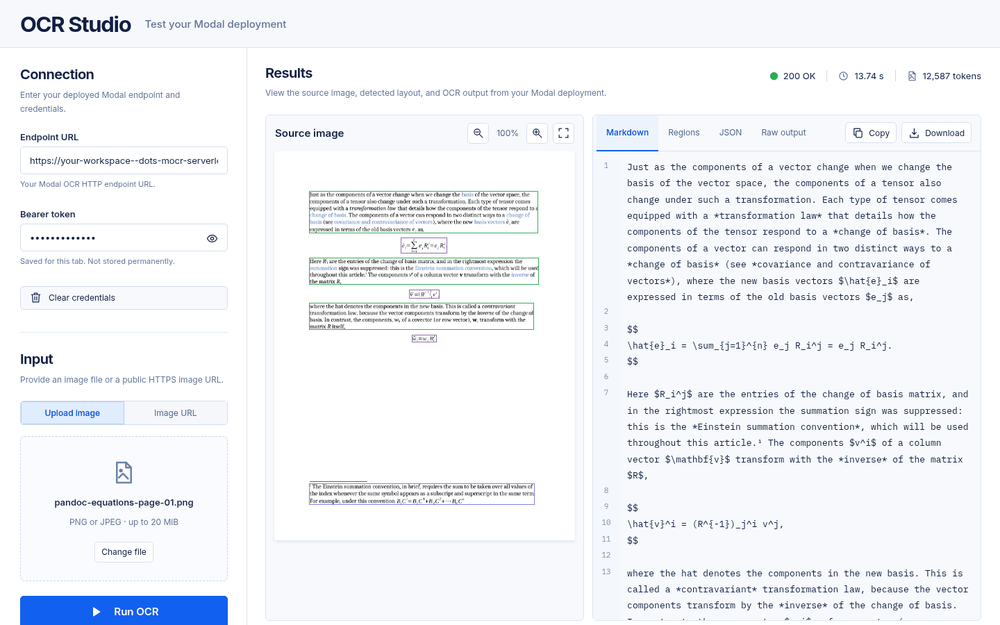

# OCR Studio

A standalone static frontend for testing the deployed dots.mocr OCR API.
GitHub Pages serves the UI; the browser calls Modal directly with a bearer
token.



## Run locally

```bash
cd playground
npm ci
npm run dev
```

Open `http://127.0.0.1:5175`, enter the deployed API URL and its
`DOTS_MOCR_TOKEN`, and upload one PNG/JPEG (up to 20 MiB) or enter a public
HTTPS image URL. Both the API base URL and the full `/v1/parse` URL work.

The connection is saved in `sessionStorage` for this tab. Clear credentials
removes the token; files and results are never persisted. If browser storage
is unavailable, the connection stays in memory. Credentials are entered at
runtime, never included in the frontend build, Actions variables, or URLs.

Inspect the source image with interactive layout boxes, rendered Markdown
(with KaTeX formulas and HTML tables), regions, JSON, and raw model output.
The Source toggle shows the Markdown text. Copy or download the selected
output. Rendered HTML is sanitized and images are dropped, so model output
cannot run scripts or load URLs. Degraded responses remain usable even without
layout boxes.

Only explicit Run OCR clicks submit requests. Stop waiting aborts the browser
request; it does not cancel GPU work. The browser stops waiting after 145
seconds because Modal's 150-second redirect fallback does not support CORS.
A failed or cancelled request may still be processing, so check Modal before
retrying. There is no automatic retry, polling, or health-check traffic.

## Configure Modal

The OCR API uses application-level authentication with `requires_proxy_auth=False`.
Create a Modal Secret named `dots-mocr-api` containing a random
`DOTS_MOCR_TOKEN`, then redeploy `modal_app.py`. The API refuses to start
without the token. CORS permits any origin, `GET`/`POST`, and the
`Authorization`/`Content-Type` headers; browser cookies are not used.
Every HTTP route still requires the bearer token except CORS preflight.

Use the [root deployment instructions](../README.md#deploy) to create the
token. The batch and benchmark clients read it from `DOTS_MOCR_TOKEN`.

## GitHub Pages

Set the repository's **Settings → Pages → Build and deployment → Source** to
**GitHub Actions**. The `playground-pages.yml` workflow builds only this package
and deploys on changes to it on `main`, or on manual workflow dispatch.
No Modal credentials are required by the workflow.

For this repository the default URL is
`https://d-nyamkhuu.github.io/dotr.mocr-serverless/`.
Vite's relative asset base supports that repository subpath, root hosting, and
custom domains without rebuilding. The app has a single entry page and needs
no server routing or SPA fallback. `npm run build` produces `dist/`.

## Verify

```bash
npm run lint
npm run build
npx playwright install chromium
npm test
```

Browser checks cover uploads, URL requests, bearer headers, tab storage,
interactive regions, downloads, authentication failures, degraded responses,
cancelled requests, and desktop/mobile layouts. They use mocked OCR responses;
they do not deploy Modal or spend GPU time.

The interface uses a navy/cobalt design with a connection/upload rail and
source/output panes. The connection uses a single OCR bearer-token field.
